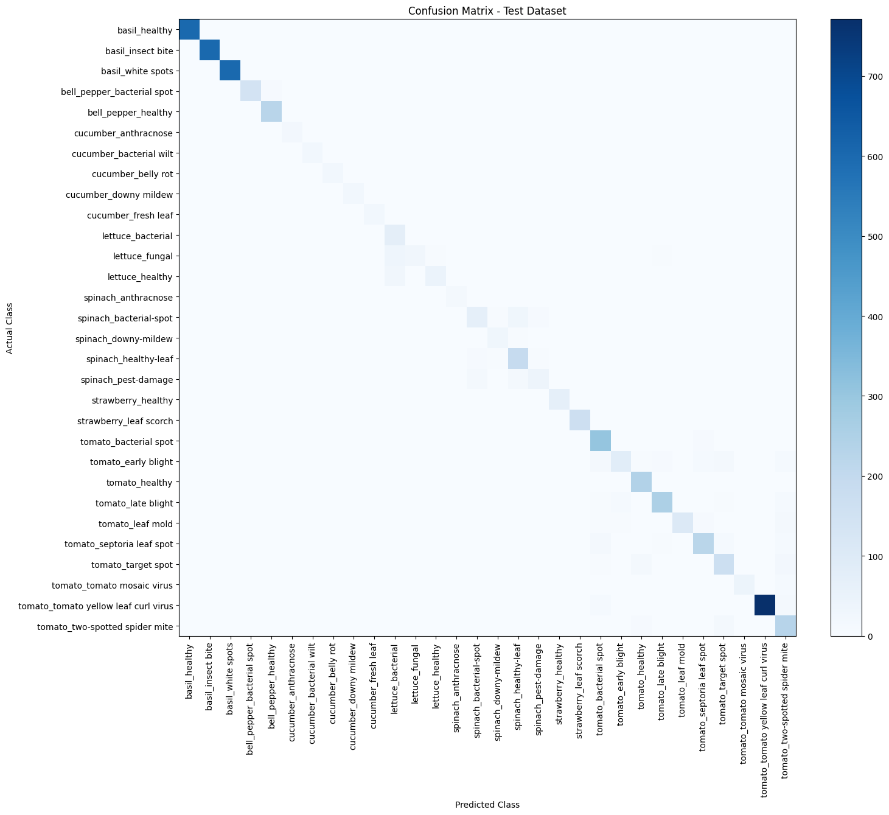

# Hydroponic Crops Disease and Condition Classification Using Deep Learning

A computer-vision system that classifies uploaded plant-leaf images into 30 plant health, disease, and pest-condition classes using a MobileNetV2-based convolutional neural network. The project includes model-training scripts, a FastAPI inference backend, a browser-based dashboard, and a held-out test evaluation.

> **Important:** Model predictions are decision-support outputs, not confirmed agronomic diagnoses. Validate predictions with appropriate expert assessment.

## Project results

The evaluated `initial_best.keras` model achieved the following results on the supplied held-out test directory:

| Metric | Result |
|---|---:|
| Test images | 5,947 |
| Number of classes | 30 |
| Test accuracy | **91.02%** |
| Test loss | 0.3618 |
| Macro precision | 87.34% |
| Macro recall | 85.34% |
| Macro F1-score | 85.10% |
| Weighted precision | 91.76% |
| Weighted recall | 91.02% |
| Weighted F1-score | 90.80% |

The macro metrics give equal weight to each class, while weighted metrics account for class support. The difference between macro and weighted F1 indicates that performance varies across classes and that class imbalance matters.

### Confusion matrix



### Class-level observations

The evaluation report shows that some classes perform strongly, while others need further work. Examples of lower-recall classes include:

| Class | Recall | F1-score |
|---|---:|---:|
| lettuce_fungal | 36.00% | 52.43% |
| spinach_pest-damage | 50.00% | 60.00% |
| tomato_early blight | 54.67% | 65.34% |
| spinach_bacterial-spot | 60.53% | 66.99% |
| lettuce_healthy | 61.84% | 74.02% |

These results suggest that class-wise data distribution, visual similarity, and dataset quality should be investigated before further model optimization.

### Plant-wise mean class recall

This is the unweighted mean of the recall values for the classes belonging to each plant group; it is not pooled plant-level accuracy.

| Plant group | Mean class recall |
|---|---:|
| Basil | 100.00% |
| Bell pepper | 96.47% |
| Cucumber | 95.00% |
| Lettuce | 65.95% |
| Spinach | 73.27% |
| Strawberry | 99.40% |
| Tomato | 82.93% |

**Evaluation caveat:** The test set is imbalanced. For example, cucumber classes in this evaluation have 24 images each, while some tomato and basil classes have hundreds. Scores from small-support classes have greater statistical uncertainty.

## Project overview

The system accepts a plant-leaf image through a web dashboard. The FastAPI backend validates the upload, resizes the image, runs inference with the trained Keras model, and returns the predicted plant, condition, confidence score, and top-five class predictions.

### Main components

- **Model:** MobileNetV2 with ImageNet-pretrained weights and a custom classification head.
- **Training:** TensorFlow/Keras scripts for model initialization and continued/recovery training.
- **Evaluation:** Held-out test evaluation with accuracy, loss, precision, recall, F1-score, classification report, and confusion matrix.
- **Backend:** FastAPI endpoints for health checks and image prediction.
- **Frontend:** HTML, CSS, and JavaScript dashboard served by FastAPI.
- **Model assets:** A trained `.keras` model and a JSON file containing the output class names.

## Repository structure

```text
Hydroponic-Crops-Disease-and-Condition-Classification/
├── README.md
├── LICENSE
├── .gitignore
├── requirements.txt
├── model_training/
│   ├── model_creation.py
│   ├── recovery_training.py
│   └── README.md
├── evaluation/
│   ├── evaluate_model.py
│   ├── test_summary.json
│   ├── classification_report.txt
│   ├── classification_report.json
│   ├── class_accuracy.json
│   └── confusion_matrix.png
└── server/
    ├── main.py
    ├── model/
    │   ├── initial_best.keras
    │   ├── class_names.json
    │   └── README.md
    └── frontend/
        ├── index.html
        ├── style.css
        └── script.js
```

The dataset is not included in this repository. The normalized confusion matrix was generated by the evaluation script; add `normalized_confusion_matrix.png` to `evaluation/` if you wish to publish that additional figure.

## Model architecture

The supplied model-creation script builds a single-stage multiclass classifier:

1. Input image: `160 × 160 × 3`.
2. Data augmentation: random horizontal flip, rotation, and zoom during training.
3. MobileNetV2 backbone: ImageNet-pretrained weights, with the backbone initially frozen.
4. Global Average Pooling.
5. Dropout with rate `0.3`.
6. Dense output layer with 30 units and softmax activation.

The model uses Adam with a learning rate of `0.001` and sparse categorical cross-entropy. MobileNetV2 preprocessing is included inside the model graph. Therefore, the inference server passes resized RGB pixel values in the `0–255` range to the model and does not apply a second normalization step.

The output class-name order must match the output-neuron order used during training. The evaluation script obtains class names from the test directory; verify that this order matches the class mapping saved during training and used by the server before treating the metrics as final.

## Training scripts

The `model_training/` directory contains:

- `model_creation.py`: loads the train, validation, and test directory datasets; writes the class-name list; builds and compiles the MobileNetV2 model.
- `recovery_training.py`: loads an existing `initial_best.keras` checkpoint, continues training with callbacks, and saves `final_model.keras`.

**Training-script scope:** The supplied `model_creation.py` ends after model compilation; it does not call `model.fit()` or create the initial checkpoint. The recovery script expects `initial_best.keras` to exist already. The training scripts use a Google Colab/Google Drive project path and may need path adjustments to run in another environment.

## Evaluation

The evaluation code is in `evaluation/evaluate_model.py`. It is intended for Google Colab and expects the project directory to be available in Google Drive at:

`/content/gdrive/MyDrive/Hydroponic_Plant_Disease_AI`

Expected dataset layout:

```text
unified_dataset/
└── test/
    ├── class_1/
    ├── class_2/
    └── ...
```

Run the script in Colab after confirming that `initial_best.keras` and the test dataset are in the expected locations. It saves a classification report, JSON metrics, and confusion-matrix images in an `evaluation_results/` folder in Google Drive.

The reported metrics in this README are transcribed from the evaluation output supplied for this project. Re-run the evaluation script if the model, test dataset, or class mapping changes.

## Backend API

The FastAPI application is in `server/main.py`.

| Method | Endpoint | Purpose |
|---|---|---|
| GET | `/api/health` | Reports whether the model is loaded and the number of classes |
| POST | `/api/predict` | Accepts an image and returns the prediction and top-five results |
| GET | `/` | Serves the dashboard |

The prediction endpoint accepts JPEG, PNG, WEBP, and BMP images up to 10 MB.

## Run locally

### 1. Requirements

- Python environment compatible with the installed TensorFlow release.
- The repository files.
- `server/model/initial_best.keras`.
- `server/model/class_names.json`.

### 2. Create and activate a virtual environment

**Windows:**

```bash
python -m venv .venv
.venv\Scripts\activate
```

**macOS/Linux:**

```bash
python3 -m venv .venv
source .venv/bin/activate
```

### 3. Install dependencies

```bash
python -m pip install --upgrade pip
pip install -r requirements.txt
```

### 4. Start the API and dashboard

Run from the repository root:

```bash
uvicorn server.main:app --host 127.0.0.1 --port 8000
```

Open `http://127.0.0.1:8000` for the dashboard. Interactive API documentation is available at `http://127.0.0.1:8000/docs`.

## Limitations and future work

- The dataset is not distributed in this repository.
- Class support is imbalanced; evaluate per-class metrics rather than relying on accuracy alone.
- Some classes have substantially lower recall and require targeted investigation.
- The supplied `model_creation.py` builds and compiles the model but does not contain the original initial training call.
- Model confidence is not a calibrated probability of a confirmed plant disease.
- The inference server resizes images directly to `160 × 160`, which may alter aspect ratio.
- Future work includes class balancing, more representative test samples, error analysis, model calibration, and external validation under real growing conditions.

## License

See [`LICENSE`](LICENSE) for the repository licence. Dataset and pretrained-weight licences may have separate terms.
